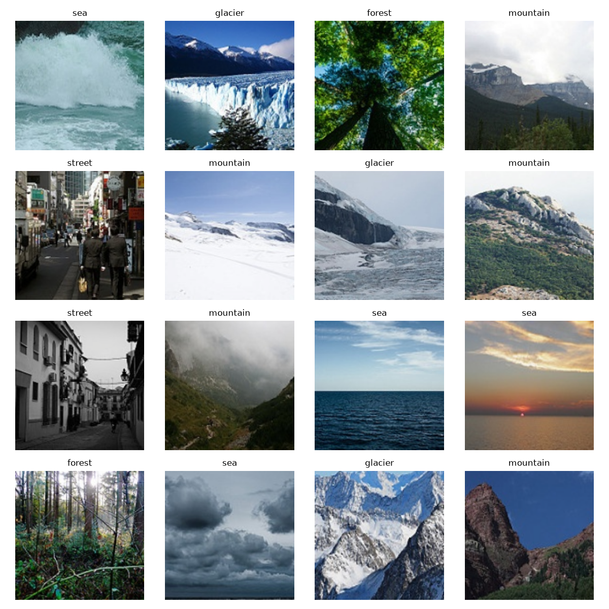
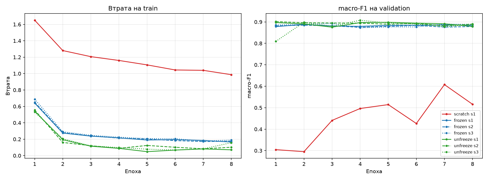
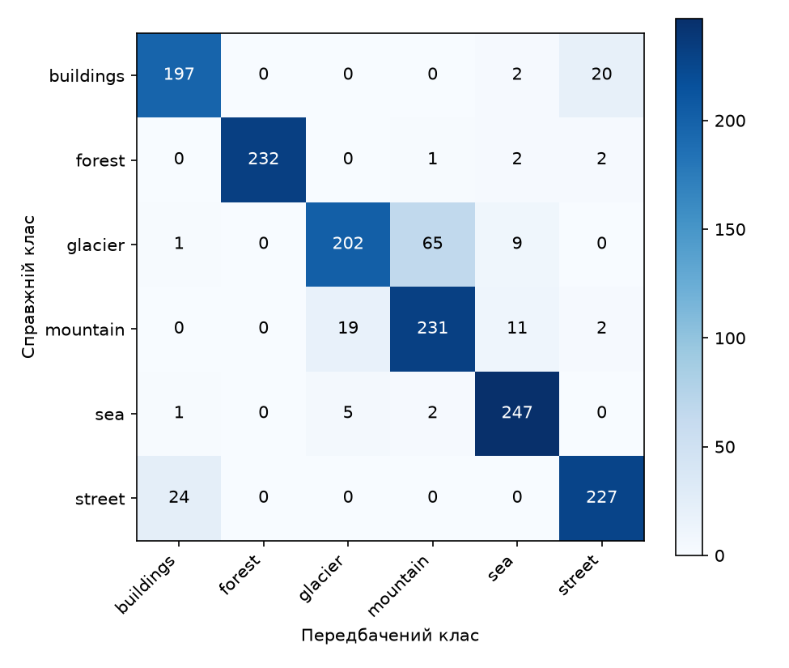
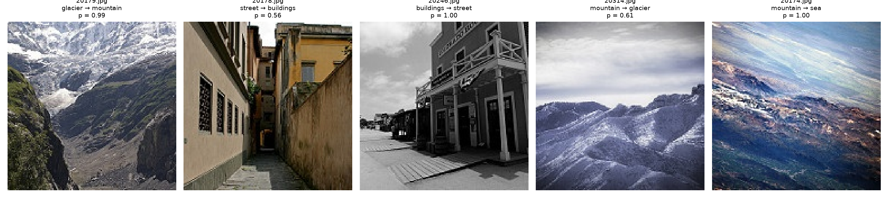

# ЛР3. Обчислювальний експеримент і трансферне навчання

## Відтворення

Обидві команди запускаються з теки `lab3/`; `<ШЛЯХ>` — локальна копія набору (тека, що містить `seg_train` і `seg_test`).

```
uv run --python 3.12 --with-requirements requirements.txt python train.py --data <ШЛЯХ>
uv run --python 3.12 --with-requirements requirements.txt python analyze.py --data <ШЛЯХ>
```

Усі тестові числа нижче взято з виводу `analyze.py` (`analysis_output.txt`). Версії бібліотек зафіксовано в `requirements.txt`; пристрій, версії та хеш коміту кожного запуску записано в його `run.json`. Значення macro-F1 при повторному навчанні можуть трохи відрізнятися (залежать від версій бібліотек і обладнання); висновки ґрунтуються на збережених журналах `runs/`.

### **Середовище і відхилення**

Python 3.12.14, PyTorch 2.15.0+cpu, torchvision 0.29.2+cpu; пристрій - CPU (Intel64 Family 6 Model 141). Версії в requirements.txt зафіксовані без суфікса +cpu (на цій системі стандартна збірка з PyPI є CPU-збіркою).

Усі сім запусків зроблено з одного коміту 243c9aa8fb706e0fed7b803ca65ee14210cdca22, git_dirty = false у всіх журналах. Хеш split.csv однаковий у всіх журналах: b29c53c7e41b0c4bb36e54d8ca3a9bcbac11eca96abeab8ba4fbcf5937a160b8.

Відхилень від фіксованих налаштувань завдання немає.

### Файли роботи

| Файл | Призначення |
| --- | --- |
| train.py | Побудова поділу, перевірки, навчання 7 запусків, вибір і збереження найкращої моделі. |
| analyze.py | Аналіз журналів, побудова графіків, єдина оцінка на test, матриця плутанини, розбір помилок. |
| split.py | Логіка поділу даних та генерація контрольної таблиці. |
| data.py | Клас Dataset, трансформації (аугментації) та завантажувачі. |
| model.py | Архітектура ResNet-18, налаштування режимів навчання та оптимізатора. |
| checks.py | Перевірки до навчання (поділ, батч, $L_0$, параметри, дослід із BN). |
| requirements.txt | Бібліотеки та їхні фіксовані версії. |
| split.csv | Зафіксований розподіл файлів на train, validation і test. |
| runs/<режим>_seed<зерно>/run.json | Логи: метрики за епохами, налаштування, час, хеші та версії. |
| runs/<режим>_seed<зерно>/val_logits.npy | Збережені логіти validation після 8-ї епохи. |
| lab3_model.pt | Ваги вибраної моделі, конфігурація та класи (≈ 45 МБ). |
| analysis_output.txt | Текстовий результат виконання analyze.py. |
| batch_after_transforms.png | Рисунок перших 16 зображень пакета після аугментацій. |
| curves.png | Графіки втрати на train та macro-F1 на validation. |
| confusion_matrix.png | Матриця плутанини для тестової вибірки. |
| errors.png | Рисунок 5 характерних помилок моделі на test. |

---

## Теоретичні відомості та формули

### А. macro-F1

Для класу k (проти решти), де $TP_k$, $FP_k$, $FN_k$ — кількості істинно позитивних, хибно позитивних і хибно негативних прогнозів:

$$
F1_k=\frac{2\,TP_k}{2\,TP_k+FP_k+FN_k},\qquad \text{macro-F1}=\frac16\sum_{k=0}^{5}F1_k .
$$

macro-F1 надає всім шести класам однакову вагу незалежно від їхнього розміру.

### Б. Початкова втрата

Для моделі з рівними ймовірностями класів $p_k=1/6$ крос-ентропія дорівнює $L=-\ln\frac16=\ln 6\approx1{,}7918$. Для ймовірностей $p$, не пов’язаних із мітками, за рівномірно розподілених міток

$$
\mathbb E[L]=-\frac16\sum_{k}\ln p_k\;\ge\;\ln 6
$$

(нерівність Єнсена, рівність лише за $p_k=1/6$). Тому для випадково ініціалізованої голови очікується $L_0\ge\ln 6$.

### В. Пакетна нормалізація і ковзні статистики

`BatchNorm2d` має параметри $\gamma,\beta$ і буфери `running_mean`, `running_var`, `num_batches_tracked`. У режимі `train()` нормування йде за статистиками $b$ поточного пакета, а буфер $r$ оновлюється ковзним середнім:

$$
r\leftarrow(1-m)\,r+m\,b,\qquad m=0{,}1 .
$$

Після $n$ пакетів вага нових даних у $r$ дорівнює $1-0{,}9^{n}$ (для $n=5$ це ≈ 0,41). У режимі `eval()` буфери не оновлюються, і нормування виконується за $r$. Прапор `training` (керується `.train()` / `.eval()`) не залежить від `requires_grad`: буфери не є параметрами. Тому для заморожених модулів недостатньо `requires_grad=False`, і `set_train_mode` після `model.train()` переводить їх в `eval()`.

### Г. Різні швидкості навчання (групи AdamW)

У `unfreeze` голова `fc` навчається з lr = $3\cdot10^{-3}$, а `layer4` — з lr = $3\cdot10^{-4}$. Голова ініціалізована випадково й потребує більших кроків; `layer4` уже містить корисні ознаки ImageNet, і великі кроки в перші ітерації могли б їх зруйнувати, перш ніж голова навчиться. Це стандартне обґрунтування, окремим експериментом у роботі воно не перевірялося.

### Ґ. Ефекти та правило інтерпретації

$F_{r,s}$ — macro-F1 на validation після 8-ї епохи для режиму $r$ і зерна $s$:

$$
\bar F_r=\frac13\sum_{s=1}^{3}F_{r,s},\qquad R_r=\max_s F_{r,s}-\min_s F_{r,s},\qquad R=\max(R_{frozen},R_{unfreeze}),
$$

$$
\Delta_{pre}=\bar F_{frozen}-F_{scratch,1},\qquad \Delta_{unf}=\bar F_{unfreeze}-\bar F_{frozen},
$$

$$
\Delta_{pre}+\Delta_{unf}=\bar F_{unfreeze}-F_{scratch,1}.
$$

Правило (окремо для $\Delta_{pre}$ і $\Delta_{unf}$): якщо $|\Delta|\le R$, різниця не відрізняється від розкиду, результату немає; якщо $|\Delta|>R$, ефект вартий перевірки, але не доведений.

**Обґрунтування.** Нехай $F_{r,s}$ за різних зерен мають стандартне відхилення $\sigma$. Для трьох нормально розподілених значень $\mathbb E[R_r]\approx1{,}69\,\sigma$ і $\mathrm{SD}(R_r)\approx0{,}89\,\sigma$; стандартна похибка різниці двох середніх із трьох запусків дорівнює $\sigma\sqrt{2/3}\approx0{,}82\,\sigma$. Отже, правило $|\Delta|>R$ в середньому вимагає різниці понад дві стандартні похибки (консервативне), але розмах трьох значень дуже неточний, тому це груба оцінка шуму, а не довірчий інтервал.

### Д. Похибка скінченності test і зміщення вибору

Для частки правильних відповідей $p$ на $n$ незалежних прикладах

$$
\mathrm{SE}(p)=\sqrt{\frac{p(1-p)}{n}},
$$

а для різниці двох незалежних половин $\mathrm{SE}\approx\sqrt2\,\mathrm{SE}(p)$. Очікуваний максимум із трьох незалежних нормальних значень перевищує їхнє середнє на $\approx0{,}85\,\sigma$; саме це визначає порядок оптимістичного зміщення валідаційного числа вибраного запуску.

---

## 1. Перевірки до навчання

### Поділ

Усі 18 клітинок збіглися з контрольною таблицею (формат «кількість / сума числових імен файлів»); жоден файл не входить у дві частини.

| Клас | train | validation | test | Збіг |
| --- | --- | --- | --- | --- |
| buildings | 200 / 1996761 | 218 / 4837323 | 219 / 4837559 | так |
| forest | 200 / 2032625 | 237 / 5276962 | 237 / 5291326 | так |
| glacier | 200 / 2183923 | 276 / 6135652 | 277 / 6157250 | так |
| mountain | 200 / 1950345 | 262 / 5789535 | 263 / 5849765 | так |
| sea | 200 / 1987613 | 255 / 5655068 | 255 / 5668011 | так |
| street | 200 / 1841817 | 250 / 5541845 | 251 / 5547533 | так |
| **Разом** | 1200 / 11993084 | 1498 / 33236385 | 1502 / 33351444 | так |

Поділ зафіксовано у файлі `split.csv` (SHA-256: b29c53c7e41b0c4bb36e54d8ca3a9bcbac11eca96abeab8ba4fbcf5937a160b8). Однаковий хеш у логах усіх 7 запусків підтверджує, що для всіх запусків використано ті самі дані. Перетину за файлами між частинами немає: жоден файл не входить у дві частини.

### Пакет після перетворень

Перші 16 зображень навчального пакета після аугментацій, з оберненим нормуванням і міткою над кожним: `batch_after_transforms.png`.



На рисунку наведено перші 16 зображень батчу після аугментацій. Обернене нормування застосовано правильно: кольори виглядають природно. Аугментації зберегли впізнаваність об’єктів. Мітки візуально збігаються з вмістом. Це підтверджує, що завантаження і перетворення працюють коректно.

### Початкова втрата

Модель за кроками 1–5 зі зерном 1; перший пакет train-завантажувача після `set_train_mode`, під `torch.no_grad()`, без кроків оптимізатора. Еталон — ln 6 ≈ 1,7918.

| Режим | L₀ | L₀ − ln 6 |
| --- | --- | --- |
| scratch | 2,0479 | +0,256 |
| frozen | 1,9244 | +0,133 |

В обох режимах L₀ перевищує ln 6. Значення ln 6 відповідає моделі, що надає всім класам однакову ймовірність, тоді як нова голова `Linear(512, 6)` зі стандартною ініціалізацією дає ненульові логіти, а ознаки після avgpool невід’ємні й мають ненульове середнє, тому початкові ймовірності класів нерівні. Якщо розподіл імовірностей не пов’язаний із мітками, очікувана втрата не менша за ln 6 (нерівність Єнсена), тож додатне відхилення очікуване. Додатково: оцінка зроблена за одним пакетом із 32 зображень з нерівномірним складом класів. Чому відхилення більше в scratch, окремо не перевірялося, а за одним пакетом і одним зерном різницю між режимами інтерпретувати не можна.

---

## 2. Перевірка режимів навчання

### Параметри

| Режим | Усього | `requires_grad=True` | Групи AdamW (параметрів, lr) |
| --- | --- | --- | --- |
| scratch | 11179590 | 11179590 | усі: 11179590, 3e-3 |
| frozen | 11179590 | 3078 | fc: 3078, 3e-3 |
| unfreeze | 11179590 | 8396806 | fc: 3078, 3e-3; layer4: 8393728, 3e-4 |

Числа збігаються з таблицею режимів. Жоден параметр із `requires_grad=False` в оптимізатор не потрапив.

### Що змінюється за 5 кроків (`set_train_mode`)

Точне порівняння (`torch.equal`) повного `state_dict()` до і після 5 кроків на перших 5 пакетах.

| Режим | Модуль | Параметри змінилися | Ковзні статистики BN змінилися | Збігається з очікуваним |
| --- | --- | --- | --- | --- |
| frozen | conv1 | ні | немає BN | так |
| frozen | bn1 | ні | ні | так |
| frozen | layer1 | ні | ні | так |
| frozen | layer2 | ні | ні | так |
| frozen | layer3 | ні | ні | так |
| frozen | layer4 | ні | ні | так |
| frozen | fc | так | немає BN | так |
| unfreeze | conv1 | ні | немає BN | так |
| unfreeze | bn1 | ні | ні | так |
| unfreeze | layer1 | ні | ні | так |
| unfreeze | layer2 | ні | ні | так |
| unfreeze | layer3 | ні | ні | так |
| unfreeze | layer4 | так | так | так |
| unfreeze | fc | так | немає BN | так |

### Дослід із навмисною помилкою (frozen, `model.train()` замість `set_train_mode`)

**Прогноз**:

> **Що зміниться.** Ковзні статистики BN (`running_mean`, `running_var`) у `bn1` і `layer1`–`layer4` (у `conv1` BN немає). Режим `train()` змушує їх оновлюватися на кожному батчі. `requires_grad=False` від цього не рятує, бо блокує лише градієнти для ваг, а не оновлення цих буферів
> 

> **Що не зміниться.** Самі ваги та зміщення замороженого кістяка. Градієнти для них вимкнені, тому оптимізатор їх не оновлює.
> 

> **Чи буде це помітно на кривій втрати train.** На кривій втрати це буде **непомітно**. У режимі `train()` шари BN виконують нормування активацій за статистиками поточного пакета. Тому класифікатор стабільно навчатиметься на цих послідовних ознаках, і втрата на `train` нормально спадатиме. Тобто, код працює без збоїв, крива навчання виглядає добре, але модель непомітно псується для етапу валідації.
> 

**Результат:**

| Модуль | Параметри змінилися | Ковзні статистики BN змінилися | Збігається з очікуваним |
| --- | --- | --- | --- |
| conv1 | ні | немає BN | так |
| bn1 | ні | так | ні |
| layer1 | ні | так | ні |
| layer2 | ні | так | ні |
| layer3 | ні | так | ні |
| layer4 | ні | так | ні |
| fc | так | немає BN | так |

**Аналіз прогнозу.** Згідно з таблицею:

- **Змінилися:** Ковзні статистики BN (`running_mean`, `running_var`) у шарах `bn1` та `layer1–layer4`. Навмисний виклик `model.train()` змусив ці буфери оновлюватися на кожному батчі. `requires_grad=False` від цього не захищає, бо блокує лише обчислення градієнтів для ваг. Саме тому перевірочний скрипт видав «ні» у стовпці «Збігається з очікуваним».
- **Не змінилися:** Параметри (ваги та зміщення) замороженого кістяка. Їхні градієнти вимкнені, тому оптимізатор їх не оновив (у стовпці «Параметри змінилися» всюди «ні», окрім цільового шару `fc`).

Максимальна абсолютна зміна в `layer1.0.bn1` за 5 кроків: `running_mean` — 0,0928364, `running_var` — 0,120314.

**Чому `requires_grad=False` не захищає ці значення.** Прапор `requires_grad=False` лише вимикає обчислення градієнтів для параметрів, тому ваги кістяка не змінюються (у таблиці параметри скрізь «ні»). Проте `running_mean` і `running_var` — це буфери, а не параметри: BN у режимі `train()` оновлює їх у прямому проході як ковзне середнє статистик поточного пакета, без участі градієнтів. Тому в замороженому кістяку з `model.train()` ваги лишаються ImageNet, а статистики дрейфують до статистик малої вибірки, і функція, яку обчислює кістяк, змінюється. Крім того, у режимі `train()` BN нормує за статистиками пакета, тож ознаки залежать від його складу.

**Чому оновлення правильне для `layer4` у `unfreeze`.** Цей блок донавчається: його ваги змінюються, і BN усередині має відстежувати зміну розподілу активацій. Якби `layer4` був у `eval()`, на validation використовувалися б застарілі статистики ImageNet, що не відповідають зміненим вагам.

---

## 3. Сім запусків

| # | Режим | Зерно | Втрата train, епоха 8 | macro-F1 validation, епоха 8 | Час навчання, с |
| --- | --- | --- | --- | --- | --- |
| 1 | scratch | 1 | 0,9865 | 0,5160 | 344 |
| 2 | frozen | 1 | 0,1655 | 0,8842 | 151 |
| 3 | frozen | 2 | 0,1757 | 0,8785 | 150 |
| 4 | frozen | 3 | 0,1896 | 0,8886 | 152 |
| 5 | unfreeze | 1 | 0,0706 | 0,8791 | 173 |
| 6 | unfreeze | 2 | 0,1020 | 0,8900 | 171 |
| 7 | unfreeze | 3 | 0,1573 | 0,8883 | 172 |

Час включає валідацію після кожної епохи. Журнали: `runs/<режим>_seed<зерно>/run.json`; логіти validation після 8-ї епохи: `val_logits.npy`.

Криві навчання семи запускі


Орієнтири із завдання виконано: режим frozen дає macro-F1 близько 0,88, а scratch помітно нижчий (хоча суттєво вищий за випадкове вгадування ≈ 0,17). Це показує, що за бюджету в 304 кроки навчання кістяка з нуля є недостатнім, тоді як трансферне навчання працює відмінно. На графіку втрат (train) криві unfreeze йдуть нижче за frozen, оскільки мережа оптимізує більше параметрів (розморожено layer4). Проте на validation їхні результати майже зливаються: розморожування layer4 не дає суттєвого приросту якості, і ця мінімальна різниця повністю перекривається розкидом між різними зернами.

---

## 4. Розклад ефектів

Позначення та правило інтерпретації наведено в розділі «Теоретичні відомості», п. Ґ.

| Величина | Значення |
| --- | --- |
| F_scratch,1 | 0,5160 |
| F̄_frozen | 0,8838 |
| F̄_unfreeze | 0,8858 |
| R_frozen | 0,0101 |
| R_unfreeze | 0,0109 |
| R = max(R_frozen, R_unfreeze) | 0,0109 |
| Δ_pre | +0,3678 |
| Δ_unf | +0,0020 |
| Δ_pre / R | ≈ 33,7: \|Δ\| > R, ефект вартий перевірки, але не доведений |
| Δ_unf / R | ≈ 0,19: \|Δ\| ≤ R, різниця не відрізняється від розкиду, результату немає |

- Сума Δ_pre + Δ_unf = 0,3698 = F̄_unfreeze − F_scratch,1 — повний виграш трансферу відносно навчання з нуля.

### Що змінює зерно і чому розкид у frozen та unfreeze може відрізнятися

Зерно (`torch.manual_seed`) задає глобальний генератор PyTorch; саме він визначає ініціалізацію ваг, порядок пакетів (`shuffle=True`), випадкові обрізки `RandomResizedCrop` і відображення в train-перетвореннях. Виклик `np.random.seed` засіває лише NumPy, який у пайплайні навчання майже не використовується: поділ має власний ізольований `default_rng(0)`.

- **scratch:** випадковою є ініціалізація всієї мережі (11,2 млн параметрів) і голови.
- **frozen, unfreeze:** ваги кістяка однакові (ImageNet), тому зерно змінює лише ініціалізацію голови `fc`, порядок пакетів і аугментацію.

Розкид може відрізнятися, бо у frozen навчається лише лінійна голова на нерухомих ознаках (3078 параметрів, BN в `eval()`), тоді як в unfreeze — `layer4` (8,4 млн параметрів) зі складнішою задачею оптимізації, а BN `layer4` у режимі `train()` додає шум, залежний від складу пакетів. Спостережені розмахи (0,0101 і 0,0109) близькі, але розмах трьох значень дуже неточний (SD(R) ≈ 0,89σ), тому твердити про різницю розкидів між режимами не можна.

### Чому R, виміряний на запусках 2–7, не характеризує розкид запуску 1

Для scratch існує лише один запуск, тож його розкид між зернами невідомий. R оцінено для режимів, у яких кістяк уже навчений, а зерно змінює лише голову, порядок пакетів і аугментацію; у scratch зерно змінює ініціалізацію всієї мережі, а статистики BN формуються з нуля, тож джерело й розмір шуму інші. Крива запуску 1 коливається між сусідніми епохами до ≈ 0,18 (0,4265 на 6-й, 0,6078 на 7-й, 0,5160 на 8-й), тобто приблизно в 17 разів більше за R (0,18 / 0,0109). Це різниця між епохами, а не між зернами, тому вона лише орієнтир, але вказує, що власний шум scratch, імовірно, набагато більший за R.

Висновок щодо Δ_pre це не змінює: навіть найвище значення scratch за епохами (0,6078) на 0,276 нижче за F̄_frozen (0,8838), тобто різниця більша за будь-яке спостережене коливання кривої. Статус «вартий перевірки, але не доведений» Δ_pre має за самим правилом |Δ| > R. Окремо слід пам’ятати, що розкид scratch не виміряно (один запуск), тому точна невизначеність Δ_pre невідома.

### Чи однаковий бюджет режимів за часом

Ні. Кількість кроків однакова (8 епох, 304 кроки), але час різний: scratch — 344 с, frozen — ≈ 151 с, unfreeze — ≈ 172 с. Scratch повільніший за frozen приблизно в 2,3 раза (градієнти й оновлення для всієї мережі); unfreeze повільніший за frozen приблизно на 14% (додатковий зворотний прохід через `layer4`), тоді як у frozen зворотний прохід іде лише через голову. Час виміряно один раз на запуск; розкид у межах режиму не перевищує 2 с, тому різниця frozen/unfreeze (≈ 21 с) значно більша за цей розкид. Отже, бюджет вирівняно за кроками, а не за часом.

---

## 5. Вибір конфігурації і тестова оцінка

### Вибір

За validation вибрано режим із найбільшим F̄ — **unfreeze** (0,8858 проти 0,8838 у frozen); серед його запусків найбільший F1 має **зерно 2** (0,8900). Ваги збережено як `lab3_model.pt` (ключі `state_dict`, `regime`, `seed`, `classes`, `img_size` = 160).

Оскільки |Δ_unf| ≤ R, **вибір між frozen і unfreeze визначив шум**, а не доведена перевага режиму. Процедура від цього не змінюється.

Команда аналізу `analyze.py` автоматично перевіряє хеш `split.csv` у журналах та підтверджує, що обрана `lab3_model.pt` відповідає правилу вибору. Метрики на test обчислюються рівно один раз у команді аналізу: на цьому етапі категорично не можна змінювати гіперпараметри чи вибір моделі, щоб уникнути підгонки (повторний запуск скрипту аналізу дозволений лише для відтворення чисел).

### Тестова оцінка (один раз, CPU, n = 1502)

| Метрика | Значення |
| --- | --- |
| macro-F1 на test | 0,8916 |
| accuracy на test | 0,8895 |
| macro-F1 на validation (вибраний запуск) | 0,8900 |
| test − validation | +0,0016 |
| √(p(1−p)/n), p = 0,8895 | 0,0081 |

Матриця плутанини (рядки — справжній клас, стовпці — передбачений):

| справжній  передбачений | buildings | forest | glacier | mountain | sea | street |
| --- | --- | --- | --- | --- | --- | --- |
| buildings | 197 | 0 | 0 | 0 | 2 | 20 |
| forest | 0 | 232 | 0 | 1 | 2 | 2 |
| glacier | 1 | 0 | 202 | 65 | 9 | 0 |
| mountain | 0 | 0 | 19 | 231 | 11 | 2 |
| sea | 1 | 0 | 5 | 2 | 247 | 0 |
| street | 24 | 0 | 0 | 0 | 0 | 227 |

Матриця плутанини


Матриця плутанини показує, що найкраще розпізнаються класи `forest` (recall 0,98) та `sea` (recall 0,97). Основна частина помилок припадає на дві специфічні пари. Найсильніше модель плутає `glacier` із `mountain` (recall для `glacier` найнижчий, ≈ 0,73) через об’єктивно нечітку межу між льодовиками та засніженими горами. Друга проблемна пара — це `buildings` і `street` (20 та 24 помилки відповідно), оскільки ці об’єкти часто присутні на одних і тих самих міських фотографіях. Інші класи змішуються рідше.

### Чи видно зміщення, спричинене вибором найкращого з трьох запусків

У наших числах — ні: macro-F1 на test (0,8916) навіть дещо вища за валідаційну (0,8900), різниця +0,0016. Вона приблизно в 5 разів менша за стандартну похибку частки правильних відповідей (0,0081), тож із неї нічого не випливає. Стандартна похибка різниці двох незалежних половин `seg_test` становить ≈ √2 · 0,0081 ≈ 0,011.

Зміщення від вибору найкращого з трьох справді існує, але невелике. За грубою оцінкою R ≈ 1,69σ, тобто σ ≈ 0,0064, очікуваний максимум із трьох перевищує середнє на ≈ 0,85σ ≈ 0,0055 (≈ 0,5 п. п.); фактичне перевищення вибраного запуску над F̄_unfreeze становить 0,0042. Обидві величини менші за шум скінченності test (≈ 0,8 п. п.) і за розкид між зернами, тому зміщення може бути непомітним або навіть мати протилежний знак: validation і test — різні випадкові половини `seg_test`, і різниця між ними містить власний випадковий складник, більший за очікуване зміщення. Додатково, похибка 0,0081 стосується accuracy, а для macro-F1 вона лише близька за порядком.

### П’ять характерних помилок

П’ять найчастіших позадіагональних пар (за кількістю; за рівності — за зростанням індексу справжнього, потім передбаченого класу); для кожної — перший за іменем файл test із такою помилкою.

| Файл | Справжній клас | Передбачений клас | Імовірність передбаченого класу | Кількість таких помилок у test | Категорія |
| --- | --- | --- | --- | --- | --- |
| 20179.jpg | glacier | mountain | 0,990 | 65 | сцена містить обидва класи |
| 20178.jpg | street | buildings | 0,559 | 24 | сцена містить обидва класи |
| 20246.jpg | buildings | street | 0,999 | 20 | сцена містить обидва класи |
| 20314.jpg | mountain | glacier | 0,609 | 19 | помилка моделі на однозначному зображенні |
| 20174.jpg | mountain | sea | 0,999 | 11 | помилка моделі на однозначному зображенні |

П’ять помилок


- **20179.jpg (glacier → mountain, p = 0,99):** Сцена містить обидва класи, оскільки в кадрі є і льодовик (угорі), і зелені скелясті схили гір (унизу).
- **20178.jpg (street → buildings, p = 0,56):** Сцена містить обидва класи, адже це вузький провулок, де вулиця невіддільна від фасадів будівель.
- **20246.jpg (buildings → street, p = 1,00):** Сцена містить обидва класи, оскільки на фото чітко видно і фасад будівлі, і вулицю з дерев’яним настилом.
- **20314.jpg (mountain → glacier, p = 0,61):** Це помилка моделі на однозначному зображенні, ймовірно спричинена засніженим хребтом і синюватою гамою, характерною для льодовиків.
- **20174.jpg (mountain → sea, p = 1,00):** Це помилка моделі на однозначному зображенні, спричинена незвичним ракурсом зверху та синіми тонами гірського рельєфу з хмарами.

**Плутанина glacier ↔︎ mountain — властивість набору.** На цю пару припадає 84 зі 166 помилок (≈ 51%); recall класу glacier найнижчий ( ≈ 0,73). Класи мають спільні ознаки (сніг, скеляста місцевість, вершини), а межа між ними нечітка. Разом із парою buildings ↔︎ street (24 + 20 = 44) ці чотири напрями дають 128 зі 166 помилок (≈ 77%).

---

## 6. Висновок

**Ефект попереднього навчання (Δ_pre).** Напрям додатний: заморожений кістяк ImageNet із навченою лише головою дає macro-F1 на validation 0,8838 проти 0,5160 у scratch. Величина ефекту — +0,3678, тобто ≈ 36,8 п. п. macro-F1; відносно розкиду R = 0,0109 це ≈ 33,7 R. За правилом |Δ| > R ефект вартий перевірки, але не доведений; за величиною він перевищує і R, і коливання scratch між епохами (до ≈ 0,18). Обмеження: scratch має один запуск, тому його власний розкид невідомий.

**Ефект розморожування (Δ_unf).** Напрям додатний, але мізерний: F̄_unfreeze = 0,8858 проти F̄_frozen = 0,8838, Δ_unf = +0,0020, тобто 0,2 п. п. macro-F1. Відносно розкиду |Δ_unf|/R ≈ 0,19, тобто |Δ| ≤ R: різниця не відрізняється від розкиду, результату немає. Розморожування `layer4` знижує втрату train (0,07–0,16 проти 0,17–0,19 у frozen), але це не переходить у помітний виграш на validation. Тому вибір unfreeze (зерно 2) для `lab3_model.pt` визначив шум.

Обидва ефекти виміряно за конкретного бюджету в 304 кроки: з довшим навчанням scratch міг би скоротити відставання, тож Δ_pre описує виграш за такого бюджету, а не принципову межу.

**Рекомендація для нової задачі:** для 200 зображень на клас я взяла б режим `frozen`: за macro-F1 він не відрізняється від `unfreeze` (|Δ_unf| = 0,0020 ≤ R = 0,0109), а навчається швидше (≈ 151 с проти ≈ 172 с), тоді як `scratch` за 304 кроки значно відстає.

Гіпотеза поза виміряними даними: для цільових зображень, що сильно відрізняються від домену ImageNet, розморожування могло б виправдатися; у цій роботі це не перевірялося.

---

## Джерела та використання ШІ

- Набір даних: [Intel Image Classification (Kaggle)](https://www.kaggle.com/datasets/puneet6060/intel-image-classification).
- Генеративні інструменти: Claude Sonnet 5.5 (Anthropic) використано для допомоги з кодом, поясненнями й чернеткою цього README.
